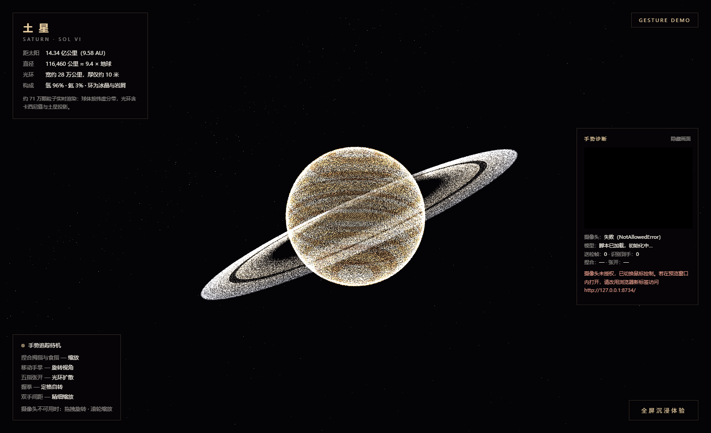

# 土星粒子渲染 + 手势控制

用 **40 万颗 GPU 粒子**实时渲染土星，支持通过**摄像头手势**缩放和旋转视角。



> 画面中的每一颗白点都是一个独立的粒子。
> 星球本体 30 万颗 + 光环 40 万颗 + 背景星空，共约 **71 万颗**。

---

## 技术亮点

### 1. 球面均匀采样（而不是随机分布）

```javascript
const t = (i + 0.5) / PLANET_COUNT;
const phi = Math.acos(1 - 2 * t);                  // 面积均匀映射
const theta = Math.PI * (1 + Math.sqrt(5)) * i;    // 黄金角螺旋
```

**如果随机撒点会怎样？** 两极会严重堆积、赤道稀疏。

因为越靠近极点，纬线圈的周长越短 —— 同样数量的点挤在更小的面积上，密度就不均匀了。

**解决办法分两步：**

1. `acos(1 - 2t)` 把"角度均匀"映射成"**面积均匀**"
2. 再用**黄金角**（约 137.5°）错开相邻点的角度，避免点挤成一团

这和**向日葵种子的排列**是同一个原理。

---

### 2. 自定义 GLSL 着色器（而不是现成的 PointsMaterial）

```javascript
const pointVertex   = `...`;   // 顶点着色器
const pointFragment = `...`;   // 片元着色器

const mat = new THREE.ShaderMaterial({ ... });
```

Three.js 自带的 `PointsMaterial` 只能调大小和颜色。但这个项目需要：

| 效果 | 说明 |
|---|---|
| **按光照方向算明暗** | 土星有明确的明暗面 |
| **被星球遮挡的粒子变暗** | 光环绕到星球背后的那一段应该是暗的 |
| **呼吸 / 闪烁动画** | 时间驱动的亮度变化 |
| **近大远小** | 粒子尺寸随距离衰减 |

这些必须在 GPU 里逐粒子计算，所以要自己写顶点和片元着色器。

---

### 3. 真实的天文比例（不是随便画的圈）

```javascript
const R_IN = 1.30;     // 内环半径（土星半径的倍数）
const R_OUT = 2.38;    // 外环半径
const CASSINI = 1.93;  // 卡西尼缝的位置
```

**土星环不是一整块实心圆盘**，而是成千上万条细环，中间有大量空隙。

最大的一道缝隙叫 **卡西尼缝（Cassini Division）**，位于 1.95 倍土星半径处，
是**土卫一的引力共振**把那个区域的物质"清空"形成的。

项目里在 1.93 处专门留了这条缝，环的颜色也从内圈的暖象牙渐变到外圈的冷灰蓝。

另外还做了**土星投影** —— 星球挡住光线时，会在环上投下一道暗影。
真实观测中这道影子非常明显，是判断土星季节的依据之一。

---

## 技术栈

| 分类 | 选型 |
|---|---|
| 3D 渲染 | Three.js（WebGL） |
| 着色器 | GLSL（自定义顶点/片元着色器） |
| 手势识别 | MediaPipe Hands |
| 语言 | 原生 JavaScript（单文件，无构建步骤） |

---

## 交互方式

| 操作 | 效果 |
|---|---|
| **捏合拇指与食指** | 缩放（拉近 / 推远） |
| **移动手掌** | 旋转视角 |
| **五指张开** | 光环扩散 |
| **握拳** | 定格自转 |
| **双手间距** | 精细缩放 |
| **拖拽鼠标** | 旋转视角（摄像头不可用时） |
| **滚轮** | 缩放（摄像头不可用时） |

> 手势功能需要摄像头权限，浏览器要求 **HTTPS** 或 **localhost** 环境。

---

## 运行方式

本项目依赖 Three.js 和 MediaPipe Hands。由于体积较大（约 25 MB），
**未提交到仓库**，需要先下载依赖：

```bash
# 依赖放置位置
vendor/
├── three.module.js              # Three.js
└── mediapipe/                   # MediaPipe Hands
    ├── hands.js
    ├── hands_solution_*.wasm
    ├── hands_solution_*.js
    ├── hands.binarypb
    ├── hand_landmark_*.tflite
    └── hands_solution_packed_assets.*
```

详细步骤见 [docs/依赖说明.md](docs/依赖说明.md)。

依赖就位后，用任意静态服务器打开：

```bash
python -m http.server 8000
# 然后访问 http://localhost:8000
```

> ⚠️ 直接双击 `index.html`（`file://` 协议）会因为浏览器的 CORS 限制无法加载模块，
> 也会拿不到摄像头权限。必须用 HTTP 服务器。

---

## 项目结构

```
saturn-gesture-demo/
├── index.html              核心代码（695 行，含着色器与渲染逻辑）
├── screenshots/            效果截图
├── docs/
│   ├── 技术说明.md         技术细节与常见追问
│   └── 依赖说明.md         第三方依赖的获取方式
└── README.md
```

---

## 性能说明

70 万粒子在浏览器端实时渲染，关键优化点：

1. **一次性构建 BufferGeometry**，不在渲染循环里重建几何体
2. **所有粒子属性（位置/颜色/尺寸/相位）在初始化时算好**，存进 BufferAttribute
3. **动画在 GPU 里做**（着色器里用 uniform 传时间），CPU 每帧只更新几个 uniform 变量
4. **关闭抗锯齿**（`antialias: false`），用粒子的自然柔化替代

---

## 说明

本项目部分代码由 AI 辅助生成，我负责：

- 需求与效果设计（要什么样的土星、什么交互方式）
- 视觉调优（粒子密度、颜色分带、光环形态）
- 技术验证（浏览器兼容性、手势可用性、性能表现）

---

## 参考

- [Three.js 文档](https://threejs.org/docs/)
- [MediaPipe Hands](https://developers.google.com/mediapipe/solutions/vision/hand_landmarker)
- 卡西尼缝：[NASA - Cassini Division](https://science.nasa.gov/resource/saturns-cassini-division/)
